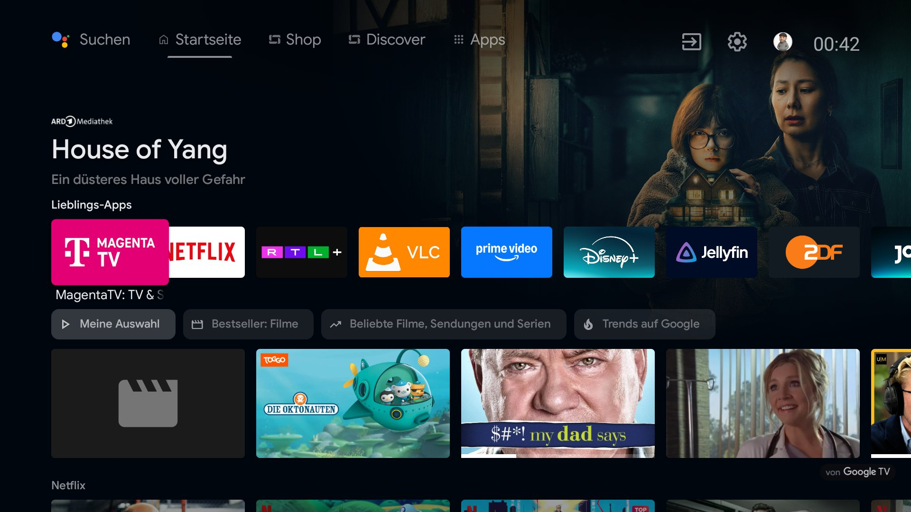
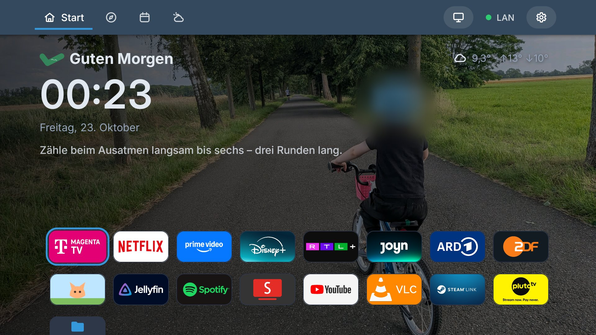
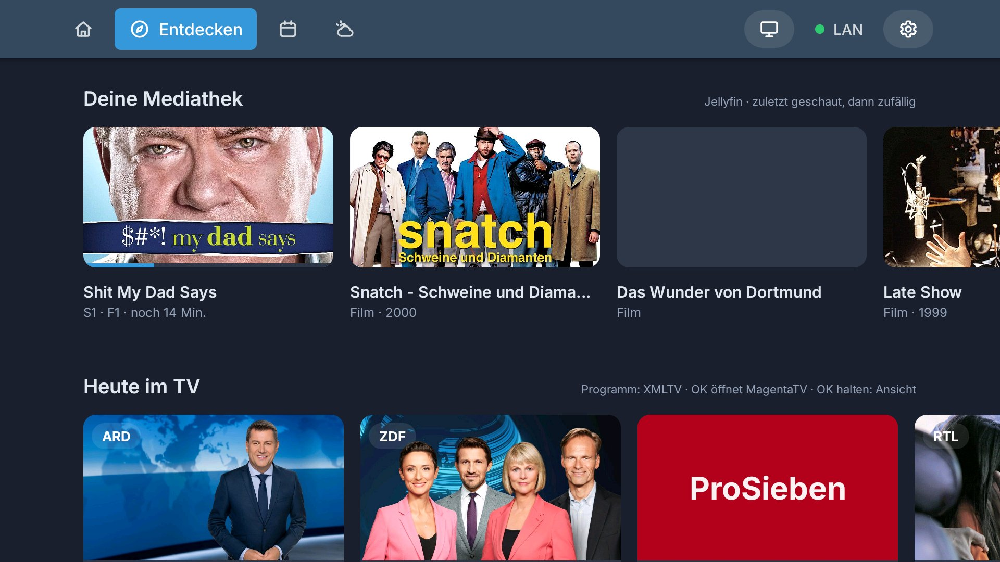
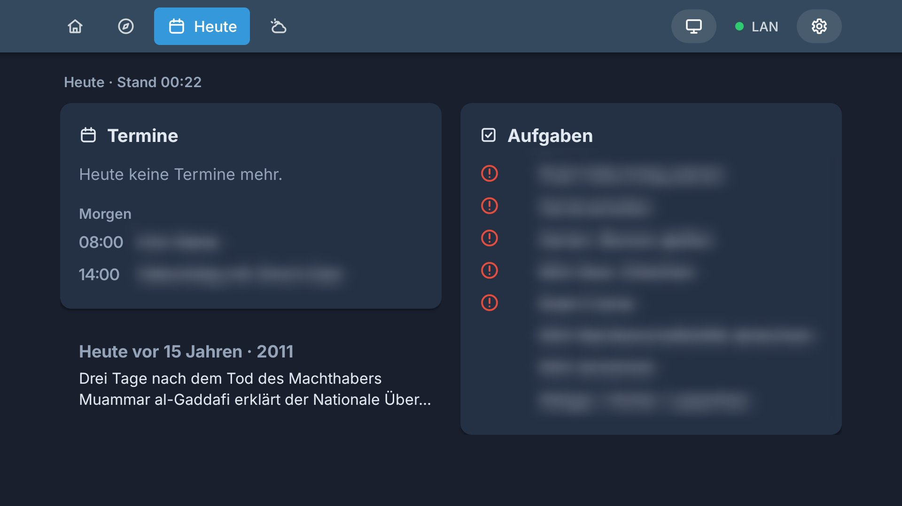
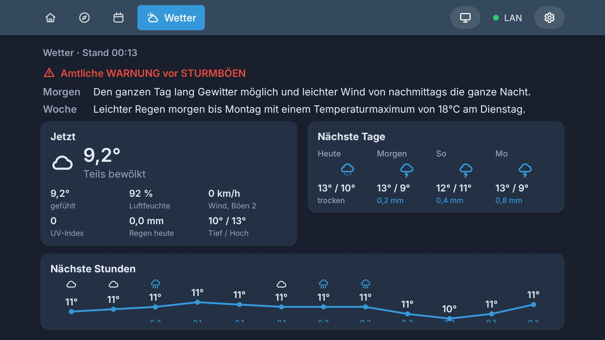

# Ich hol mir meinen Fernseher zurück

Angefangen hat alles mit einem GitHub-Repo: cleanyourtv von Gathin23. Das sind ein paar Skripte, mit denen man einen Android-Fernseher entrümpelt. Sie schalten Werbung und Datensammler ab und setzen einen schlichten Startbildschirm drauf. Das Ganze läuft über ADB, die Entwickler-Schnittstelle, mit der man ein Android-Gerät vom PC aus steuert. https://github.com/Gathin23/cleanyourtv

Eigentlich logisch. Ein Android-TV ist halt auch nur ein sehr großes Handy ohne Akku.

Unser Philips im Wohnzimmer läuft mit Android 11. Also hab ich den Laptop aufgeklappt und einfach mal aus Neugier reingeguckt.

## Was da eigentlich alles lief

Da lief deutlich mehr, als ich gedacht hätte. Philips hat gleich mehrere Programme mitgeliefert, die mitschreiben, wie wir den Fernseher nutzen, und Daten und Logs sammeln. Dazu kam eine Anmeldung, über die Werbung und Inhaltserkennung freigegeben werden. Ein weiterer Dienst zeigte Werbe-Kanäle an, mit eigener Werbe-ID. Und Google und Philips haben beide noch ihre eigenen Empfehlungen eingespielt.

Dazu kam der ganze Kram, den bei uns keiner braucht: die Ladendemo aus dem Elektromarkt, Alexa, ein Browser, ein Wecker, HD+ und die App-Galerie von Philips.

Jetzt sind 18 Pakete raus und der TV fühlt sich sofort flotter an. Und plötzlich war auch auf dem Startbildschirm wieder Platz, den ich mit eigenen Ideen füllen konnte.

## Ein Startbildschirm, der uns gehört

Oben gibt es jetzt eine Leiste mit vier Reitern: Start, Entdecken, Heute und Wetter. Bedient wird alles mit der normalen Fernbedienung. Tagsüber ist die Oberfläche hell und nachts dunkel, umgeschaltet wird nach dem Sonnenstand. Farben, Schrift und Icons hab ich von Todoteck und unseren Home-Assistant-Dashboards übernommen. Der Fernseher sieht jetzt also aus wie alles andere bei uns zu Hause.

Auf der Startseite begrüßt uns der Fernseher je nach Tageszeit, dazu kommen Uhr und Datum. Die Temperatur kommt von unserer eigenen Wetterstation, Symbol und Vorhersage über Home Assistant. Im Hintergrund ist ein Foto aus unserem Album „TV“ in Immich, unserer eigenen Fotoverwaltung. Darunter liegen unsere acht Lieblings-Apps.

Unter „Entdecken“ spielt mir kein fremder Algorithmus mehr irgendwas ein. Was dort steht, hab ich selbst über Schnittstellen festgelegt. Oben kommt unsere eigene Mediathek aus Jellyfin. Darunter stehen über die Filmdatenbank TMDB die beliebtesten und neuesten Filme und Serien, und zwar nur von den Plattformen, die wir auch wirklich nutzen. Das Fernsehprogramm von heute hole ich mir von iptv-epg.org, und verpasste Sendungen von ARD und ZDF findet der Fernseher über MediathekViewWeb und spielt sie direkt im VLC Player ab.

Unter „Heute“ stehen unsere Termine von heute und morgen, die fälligen Aufgaben aus Todoteck und ein Ereignis aus der Wikipedia, das heute vor X Jahren passiert ist.

Unter „Wetter“ stehen ganz oben in Rot die amtlichen Warnungen aus NINA. Darunter sieht man das aktuelle Wetter mit Temperatur, gefühlter Temperatur, Luftfeuchte, Wind, UV und Regen. Die nächsten zwölf Stunden zeigt eine Kurve mit Regenbalken. Dazu kommen die nächsten Tage und, wenn gerade etwas fliegt, der Pollenflug.

## Die Schlüssel bleiben im Haus

Für all diese Dienste läuft in meinem Home Lab ein eigener kleiner Dienst. Er verwaltet die API-Zugänge und entscheidet, welche Inhalte beim Fernseher ankommen. Auf dem Fernseher selbst liegt keiner dieser Zugänge.

Welche Daten wohin fließen und wo die Schlüssel liegen, hab ich festgelegt. Den Code hat Claude Code geschrieben, an drei Tagen in ein paar Stunden. Herausgekommen sind rund 6.700 Zeilen Java und 1.600 Zeilen TypeScript.

Im Kleinen ist das genau das, was ich sonst beruflich mache. Erst schauen, was da eigentlich läuft. Abschalten, was keiner braucht. Und die eigenen Daten so anbinden, dass die Schlüssel im Haus bleiben.

Jetzt zeigt der größte Bildschirm im Haus unsere Fotos und unsere Termine. Und abends nur Filme, für deren Anzeige nicht Amazon & Co. bezahlt haben, sondern die wir wirklich schauen wollen.
