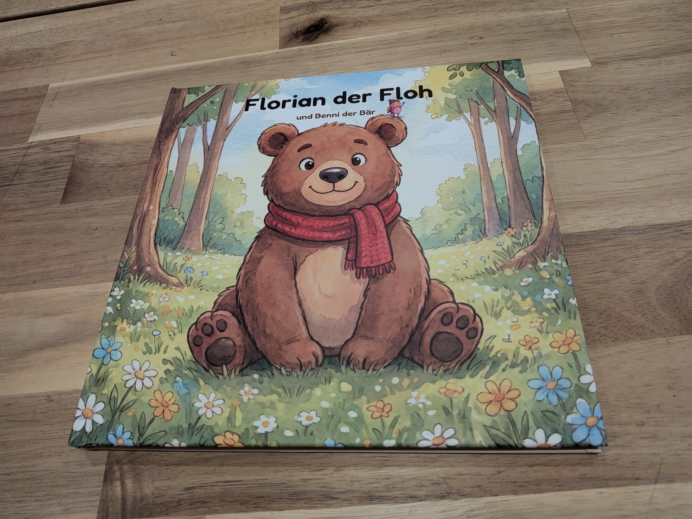
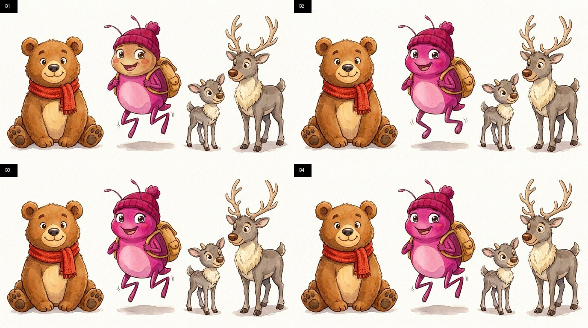
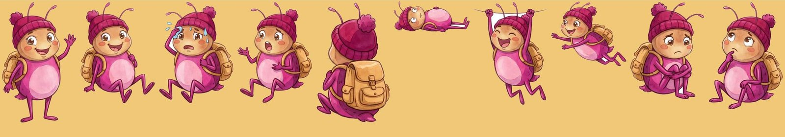
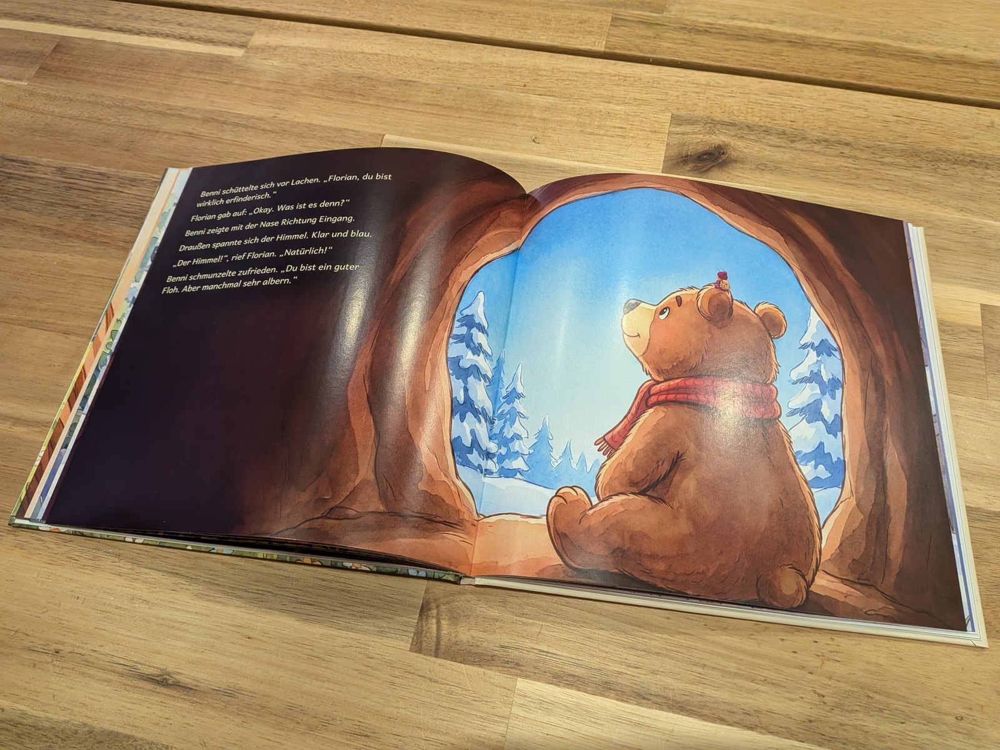

# Florian der Floh: aus Gute-Nacht-Geschichten wird ein Bilderbuch

Auf unserem Tisch liegt ein Bilderbuch, das es in keinem Laden gibt.

## Im Halbdunkel

Angefangen hat es beim Zubettbringen. Unser Sohn wollte noch eine Geschichte erzählt bekommen. Also habe ich eine erfunden. Von Florian, dem Floh. Er wohnt im Fell von Benni, dem Bären. An einem heißen Sommertag wird es ihm dort zu warm („Benni, gerade bist du ein Bratbär"). Also krabbelt er bis zum Ohr und ruft, so laut er kann.

Am nächsten Abend: „Papa, erzähl noch mal von Florian, dem Floh!"

Am übernächsten auch.

Irgendwann haben wir die Geschichten aufgeschrieben. Drei Kapitel sind es geworden. Ein wenig geglättet, im Kern so gelassen, wie man sie sich abends im Halbdunkel ausdenkt.

## Papa kann nicht zeichnen

Und ich wollte ein richtiges Kinderbuch für meinen Sohn daraus machen.

Nur bin ich kein Zeichner.

Kein Grafiker.

Kein Illustrator.

Die Geschichten sollten trotzdem bleiben. Also kommen die Bilder aus der KI. Von allein ging das aber nicht.

## Erst die Figuren, dann die Bilder

Ein Bildmodell malt jedes Bild neu. Ohne genaue Vorgabe hat Benni auf jeder Seite ein anderes Gesicht. Mal mit Schal, mal ohne. Für ein Kind, das die Figuren genau im Kopf hat, geht das nicht.

Deshalb kam vor dem ersten Bild die Beschreibung. Wie sieht Benni aus? Was trägt Flo? Wie groß ist das Rentier? Das wusste unser Sohn ganz genau. Ich habe es aufgeschrieben, so genau es ging.

Daraus wurde ein Figurenblatt. Ein Bär mit rotem Schal. Ein Floh mit Pudelmütze und Rucksack. Das Rentier Friedrich, einmal als Baby und einmal groß. Vier Varianten, eine ausgesucht.

Das Blatt geht bei jedem neuen Bild als Vorlage mit. Damit Benni auf Seite 30 noch so aussieht wie auf Seite 2.

Die Szenen malt ein Bildmodell im Aquarell-Stil, immer gleich als ganze Doppelseite. Den Text setzt ein Python-Skript darüber. Das Druck-PDF kommt auch aus Python.

## Der Floh ist zu klein

Blieb der Held. Ein Floh auf einem Bären ist im Bild nur ein paar Millimeter groß. So klein bekommt ein Bildmodell eine Figur nicht jedes Mal gleich hin.

Also andersrum. Die Szenen entstehen ohne Floh. Flo gibt es dafür einzeln, in zehn Posen. Winkend, schwitzend, fliegend, schmollend.

Ein Skript setzt ihn in jede Szene. Wo er sitzt, wie groß er ist und ob er einen Schatten wirft, steht in einer Datei. Flo ein Stück nach links? Zahl ändern, neu laufen lassen.

Und weil er so klein ist, muss man ihn auf jeder Bildseite suchen. Die letzte Seite fragt: „Hast du Flo überall gefunden?"

## Auflage: privat

Zu kaufen gibt es das Buch nicht. Es ist für genau einen Leser gemacht.

Der kennt die Geschichten sowieso auswendig. Neu sind für ihn nur die Bilder. Und ein Floh, den man suchen muss.

Er sagt, er hat jetzt ein Kinderbuch, das niemand sonst auf der Welt hat.

Ganz stolz.
