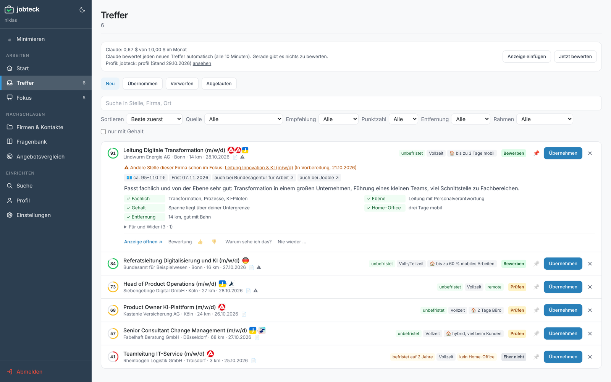
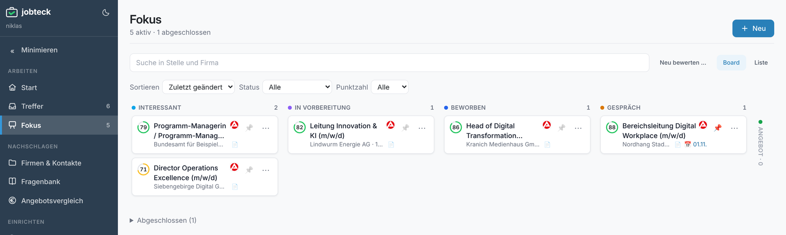
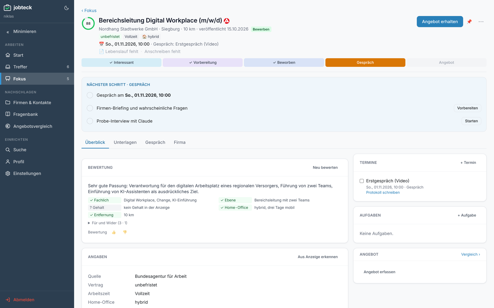
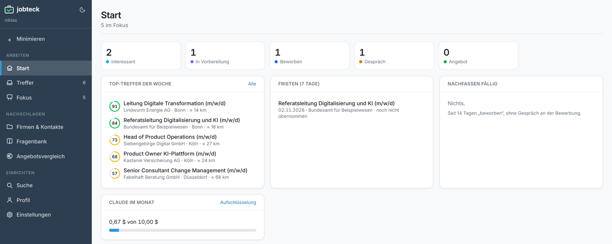

# Jobteck: Meine Jobsuche hat jetzt eine eigene App

Seit August bin ich nicht mehr bei RTL. Auch wenn die Zeit bis zum Frühjahr weiterhin meiner Familie gehört, bereite ich mich jetzt auf die Zeit danach vor, damit die Jobsuche dann auch klappt.

Und Jobsuche heißt vor allem: Portale.

Bundesagentur. StepStone. LinkedIn. Indeed. XING. Dazu die Karriereseiten der Firmen, die mich wirklich interessieren.

Jeden Tag dieselben Anzeigen, nur woanders. Jeden Tag dieselbe Frage: Hab ich die nicht schon gesehen?

Erst mal bei GitHub & Co. geschaut, was es schon an selbst gehosteten Lösungen gibt, diese Suchen zu bündeln. Nichts davon hat wirklich gepasst.

Also selbstbauen (lassen) mit Claude Code. Natürlich.

## Was Jobteck macht

Jetzt sammelt meine persönliche Karriere-Anwendung "Jobteck" nachts Stellen ein. Von der Bundesagentur, von service.bund.de, über die API von Jooble, das Anzeigen vieler Plattformen zusammenträgt, und direkt aus den Bewerbungssystemen meiner Wunscharbeitgeber. Adresse der Karriereseite reinkopieren reicht. LinkedIn, Indeed, StepStone und XING kommen über Jooble oder über ihre Job-Alert-Mails, die Jobteck aus meinem Gmail-Postfach liest.

Dieselbe Stelle aus zwei Quellen wird ein Treffer. Entfernung, Gehalt und Bewerbungsfrist rechnet Jobteck selbst aus. Ohne KI. Auch aus "E 13 TVöD" wird so ein Jahresbrutto.

Liefert eine Quelle nur ein paar Sätze, sucht Jobteck die ganze Anzeige. Notfalls holt eine kleine Browser-Erweiterung sie aus meinem eigenen Browser.

Mein Profil mit Lebenslauf und Suchkriterien pflege ich in [Todoteck](#todoteck), Jobteck liest es nur. Was gesucht wird, steht in Suchprofilen mit Begriff, Ort und Umkreis. Zeitarbeit und Firmen, die ich nicht will, sortiert eine Ausschlussliste aus, bevor überhaupt eine KI etwas kostet.

Erst dann kommt die Claude-API ins Spiel. Ein günstiger Vorfilter sortiert entsprechend meiner Suchfilter grob aus. Was übrig bleibt, bekommt eine Punktzahl von 0 bis 100 und eine Begründung, ob die Stelle zu mir und meinen Skills passen könnte.

Ich kann jeder Bewertung einen Daumen hoch oder runter geben, und meine Urteile fließen in die nächsten Bewertungen ein. Daraus schlägt Claude mir auch vor, wie ich meine Suchkriterien schärfen kann und welche Jobtitel ich noch suchen sollte.

## Wenn's ernst wird

Alles, was ich weiterverfolge, wandert in den Fokus. Ein Board von "Interessant" bis "Angebot", mit dem nächsten Schritt je Phase.

Für diese Stellen kann ich direkt in Jobteck meinen Lebenslauf und mein Anschreiben verfassen und übersichtlich speichern. Claude gleicht mein hinterlegtes Profil mit der Stellenanzeige und meinem Textentwurf ab und weist mich auf Unstimmigkeiten hin. Verschickte Bewerbungen landen als Notiz in Todoteck.

Und wenn es zum Gespräch kommt, bereitet Jobteck ein Firmen-Briefing und die wahrscheinlichen Fragen vor.

## Was es kostet und wo die Daten bleiben

Über mein Claude-Abo habe ich ohnehin ein Gratis-Kontingent für die Claude-API. Da passt das locker rein.

Trotzdem hat Claude in Jobteck ein Monatsbudget. Als Sicherheitsnetz, falls mal irgendwas aus dem Ruder läuft. Vorgabe: 10 Dollar. Die Sperre greift vor dem Aufruf, nicht erst auf der Rechnung. Die gründliche Bewertung läuft nachts im Batch zum halben Preis.

Die Tage will ich aber auch mal ein lokales LLM auf meinem PC dafür testen. Dann bleibt alles im Haus.

Jobteck läuft nur bei mir im Heimnetz. An Claude geht nur, was ich ausdrücklich als Profil markiert habe. Name, Adresse und Foto nie.

## Nach den ersten Tagen

Die ersten Erfahrungen sind super.

In den ersten Nächten landeten jeweils rund 20 neue Treffer in Jobteck, und ich schaue mir zuerst die an, die mehr als 80 Punkte bekommen haben.

Kein Scrollen durch drölf Job-Mails. Kein Springen zwischen fünf Portalen mit fünf Arten von Unübersichtlichkeit. Bessere Treffer, keine Doppelten. Und ich sehe auf einen Blick, was ich mir schon angesehen und worauf ich mich dann schon beworben habe.

Jobteck nimmt mir das Sortieren ab. Das Entscheiden nicht. Und das Gespräch führe ich auch noch selbst.
