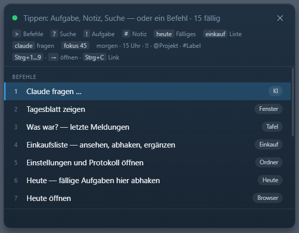

# Karl Klammer am Desktop

Seit ein paar Wochen steht auf meinem Windows-Desktop ein Haken mit Augen.

Das ist Tecki, das Maskottchen von [Todoteck](https://niklasfauteck.de/blog/#todoteck), meiner selbstgebauten Aufgaben-App. Der Haken und seine Geometrie kommen direkt aus dem Logo und der App. Nur dass er jetzt Augen hat. Und auf dem Schreibtisch sitzt.

Er zeigt mir zum Beispiel, was Claude gerade tut: denkt nach, wartet auf Freigabe, fertig, Fehler. Er zeigt mir, was in Todoteck fällig ist. Und wenn Claude eine Frage hat, stellt er sie mir.

Reines Nerd-Projekt. Braucht eigentlich kein Mensch. (Ich wollte ihn trotzdem.)

## Die Büroklammer

Jeder, der um die Jahrtausendwende Word benutzt hat, kennt sie. Karl Klammer. Clippy. Man tippt einen Brief, und plötzlich hüpft unten rechts etwas auf und will helfen.

Tecki will auch helfen. Nervt aber weniger. Er wartet, bis ich ihn frage. Und Claude darf mir über ihn Fragen stellen.

Das läuft über [MCP, wie schon die Todoteck-Anbindung an Claude](https://niklasfauteck.de/blog/#todoteck-mcp). Die Sprechblase bekommt pro Antwort einen Knopf und ich antworte per Klick. Kein Fensterwechsel, kein Suchen nach dem richtigen Tab. Ich tippe weiter, bis ich Lust habe zu antworten.

## Was er sonst noch kann

Die Ampel. Claude Code schickt über ein Hook-Skript seine Zustände an Tecki und an [Home Assistant](https://niklasfauteck.de/blog/#home-assistant). Im Büro hängt ein LED-Streifen dran. Denkt nach: eine Farbe. Wartet auf meine Freigabe: eine andere. Fehler: rot. Ich sehe vom Flur aus, ob Claude auf mich wartet.

Die Befehlspalette. Strg+Alt+Leertaste, und ich bin in Todoteck, ohne Browser. „morgen 15 Uhr Müll rausstellen !! @Home" wird zur Aufgabe mit Termin, Priorität und Projekt. „heute" zeigt, was fällig ist, und ich hake direkt ab. „einkauf" die Einkaufsliste. „claude …" stellt eine Frage. Noch ein Eingang in dieselbe App, so wie [der Telegram-Bot](https://niklasfauteck.de/blog/#einfach-reinquatschen) für Aylin.

Und die Physik. Man kann ihn ziehen und werfen. Schwerkraft, die Taskleiste ist der Boden, zwei Hüpfer, Ruhe. Wer ein Fenster schnell über ihn schiebt, stößt ihn um. Das ist der Schubser. Hat keinen Nutzen. Ist aber lustig.

Bei Regen hat er Tropfen über dem Kopf. Ab 28 Grad gefühlt eine Schweißperle. Die Daten kommen aus Home Assistant. (Ja, ich weiß. Aber es kostet nichts, und ich grinse jedes Mal.)

## Unter der Haube

Tauri 2, Rust plus WebView2, rund 10.000 Zeilen, 77 Tests. Gevibecodet mit Claude Code, Phase für Phase, mit [demselben Setup](https://niklasfauteck.de/blog/#claude-code-setup-codequalitaet), das auch den Rest von Todoteck prüft.

Karl Klammer hat Microsoft 2007 in Rente geschickt. Tecki sitzt gerade neben der Uhr und blinzelt.
