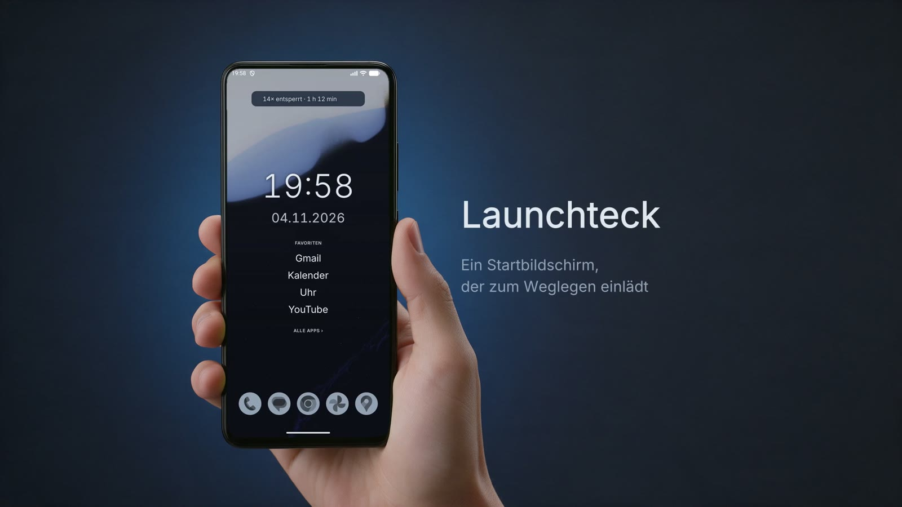
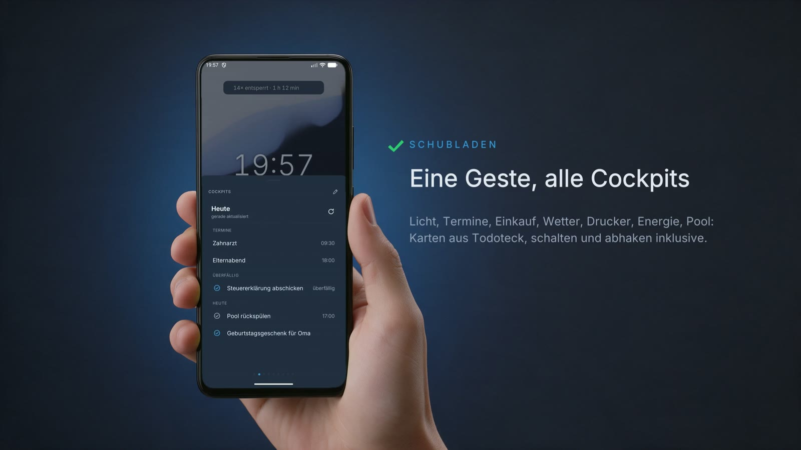
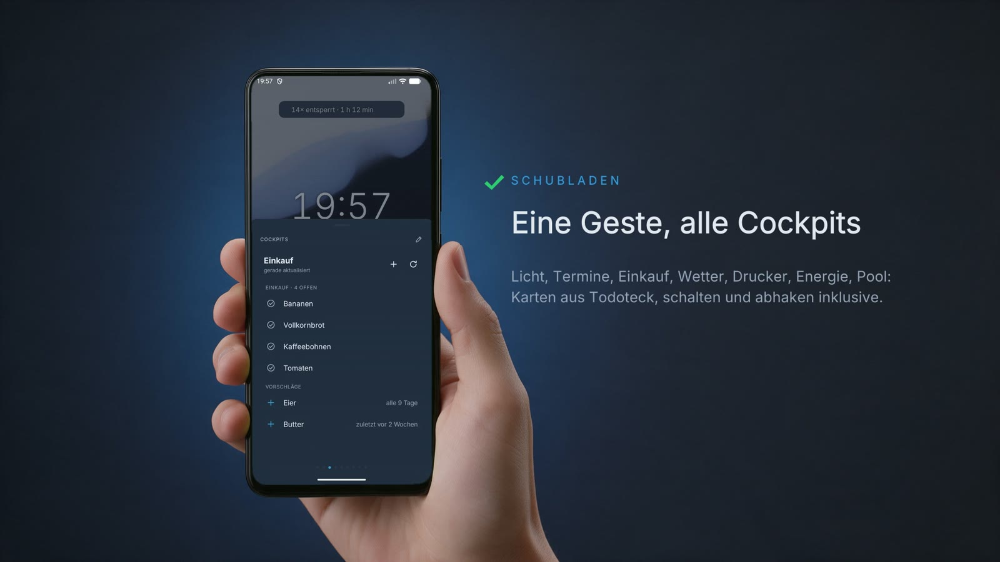
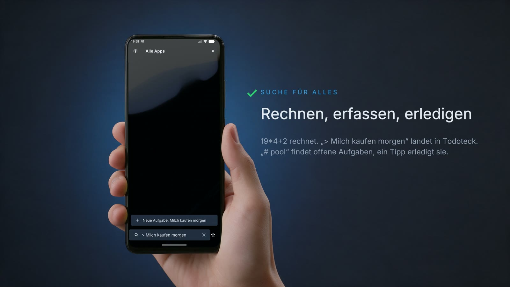

# Launchteck: ein Startbildschirm zum Weglegen

Ich nehme mein Handy zu oft in die Hand.

Fast hätte ich mir ein Dumbphone gekauft. Eins, das gerade smart genug ist für WhatsApp und Co. Nur kosten die so viel wie ein richtiges Smartphone. Sah ich nicht ein.

Also mache ich es mir selbst ein bisschen umständlicher. Mit einem Startbildschirm, der zum Weglegen einlädt.

Keine Badges.

Keine Wand aus Apps.

Nur die Uhr, ein paar Favoriten und Ruhe.

## Lieber umbauen

Es gibt unzählige Android-Launcher da draußen (bei Android lässt sich der Startbildschirm austauschen). Niagara hat die schlichte Liste, die ich mag. Aber keine Gesten für Aktionen. Lawnchair hat die Einstellungen, die ich mag. Keiner sieht aus wie Todoteck, unsere selbst gehostete Familien-App. Und keiner redet mit ihr.

Neu bauen musste ich trotzdem nicht. Aufgebaut ist Launchteck auf [µLauncher](https://github.com/jrpie/Launcher), einem schlanken Open-Source-Launcher. Gesten und App-Liste habe ich behalten, Gestaltung und Einstellungen neu gemacht. Farben, Schrift und Icons kommen direkt aus Todoteck.

Gevibecodet mit Claude Code, an zwei Tagen.

## Was er kann

Ganz oben steht eine stille Zeile: wie oft ich das Handy heute entsperrt habe und wie lange es an war. Ab drei Stunden gähnt mein Maskottchen [Tecki](https://niklasfauteck.de/blog/#karl-klammer-am-desktop).

Darunter Uhr, Datum und meine Favoriten. Alles andere ist eingeklappt.

Widgets liegen dort keine. Die stecken in Schubladen. So heißen bei mir die Widget-Stapel, die eine Geste von unten hochschiebt. Dann wische ich durch:

Licht schalten.

Termine von heute.

Einkaufsliste abhaken.

Wetter, Drucker, Energie, Pool.

Rein, Licht aus, weg. Ohne dass sich eine App öffnet und mich festhält.

Und die Suche findet mehr als Apps. Ein Größer-Zeichen davor, und „Milch kaufen morgen" landet als Aufgabe in Todoteck. Mit „# pool" sehe ich die offenen Pool-Aufgaben, ein Tipp hakt sie ab.

Zwei Tage auf den Bildschirm gestarrt, damit ich weniger auf den Bildschirm starre.

(Ja, ich weiß. Ich lege es jetzt weg. Gleich.)

## Weiterlesen

- [Todoteck: Vibecoding für die Familie](https://niklasfauteck.de/blog/#todoteck): wo das alles herkommt
- [Todoteck: API, MCP und der Alltag](https://niklasfauteck.de/blog/#todoteck-mcp): die Schnittstelle, über die Launchteck redet
- [Der Knopf am Handgelenk](https://niklasfauteck.de/blog/#sprachgeraet-am-handgelenk): noch ein Gerät, das an Todoteck hängt
- [µLauncher von jrpie](https://github.com/jrpie/Launcher): das Original
